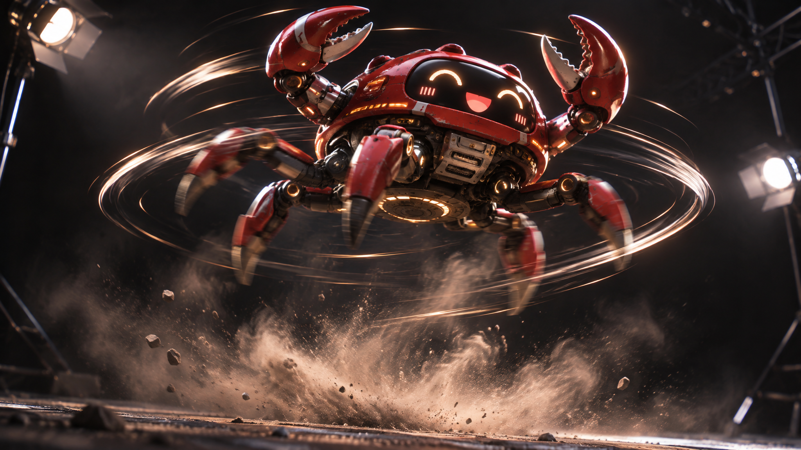

# 🦀 螃蟹机器人 · 七梗皮肤 × 七专属动作

**螃蟹机器人开源动作大赛 2026 参赛作品** · Crab Robot Challenge 2026 entry

基于开源六足螃蟹机器人 [Jumper](https://github.com/KingKongRobotics/jumper)（22 自由度），
本仓库交付 **7 款网络热梗皮肤** + **7 个为每款皮肤量身训练的专属动作** + **旋风跳**，
全部通过官方 `verify-package` 校验，可直接上传 [beunlimited.me](https://beunlimited.me/zh/simulator) 仿真。

> 主题：好看 · 好玩 ·有用（Beautiful · Playful · Useful）

---

## 🎨 七款皮肤（.skin，官方校验通过）

每款都是**真 3D 雕刻件**（Blender 建模）+ 屏幕表情，不是贴图。点图看 AI 概念渲染。

| 皮肤 | 梗 | 设计亮点 | 概念图 |
|---|---|---|---|
| 🦫 卡皮巴拉 | 头顶橘子 | 水豚棕壳 + 呆滞小耳 + 带叶橘子 + 口鼻贴片 | [图](skins/ai/ai_skin_capybara_tangerine.png) |
| 🐱 妙脆角小猫 | 三角脆片猫 | 亮橙三角脸 + 折耳 + 白胡须 + 粉肉垫钳 | [图](skins/ai/ai_skin_dorito_cat.png) |
| 🦞 打工人龙虾 | AI 打工图腾 | 深红龙虾壳 + 长触须 + 工牌挂绳 + 困倦眼睑 | [图](skins/ai/ai_skin_lobster_worker.png) |
| 🦝 背手负鼠 | 大爷踱步 | 灰褐绒毛 + 粉耳粉尾 + 双钳真·背在身后 | [图](skins/ai/ai_skin_possum_elder.png) |
| 🐴 马年小金马 | 2026 丙午马年 | 金壳 + 栗色鬃毛脊冠 + 三缕马尾 + 红绳结铃铛 | [图](skins/ai/ai_skin_golden_horse.png) |
| 😺 猫meme | 贱萌斜眼 | 黑白配色 + 屏幕超大斜眼 + 下垂嘴角 | [图](skins/ai/ai_skin_cat_meme.png) |
| 🥒 酸黄瓜 | 自嘲顶流 | 墨绿疙瘩壳（64 颗凸起）+ 酸皱表情 | [图](skins/ai/ai_skin_pickle_sour.png) |

皮肤文件：[`skins/*.skin`](skins/) · 真渲染预览：[`skins/previews/`](skins/previews/)

## 🎬 七个专属动作（强化学习模仿训练）

每个动作是为对应皮肤手编的舞，用 PPO 模仿训练到收敛，导出 ONNX + 轨迹，可上真机。

| 动作 | 皮肤 | 内容 | 训练 reward | 演示 |
|---|---|---|---|---|
| 泡温泉发呆 | 卡皮巴拉 | 低姿泡澡 + 晃悠 + 久坐发呆 | 28.0 | [视频](skins/gesture_capybara_soak.mp4) |
| 伸懒腰 | 妙脆角 | 前爪远伸 + 拱背长保持 | 42.2 | [视频](skins/gesture_dorito_stretch.mp4) |
| 上班摸鱼 | 龙虾 | 蔫蹲 + 叹气两下 + 单臂懒摆 | 43.8 | [视频](skins/gesture_lobster_otaku.mp4) |
| 背手踱步 | 负鼠 | 双钳背身后 + 重心脉冲踱步 | 39.3 | [视频](skins/gesture_possum_patrol.mp4) |
| 小马扬蹄 | 金马 | 原地弹跳 + 前蹄刨地 + 昂首 | 36.1 | [视频](skins/gesture_horse_prance.mp4) |
| 贱萌歪头 | 猫meme | 左歪右歪 + 单爪轻点 + 好奇前倾 | 45.4 | [视频](skins/gesture_catmeme_tilt.mp4) |
| 酸到发抖 | 酸黄瓜 | 全身抖动 + 酸蹲 + 再抖缓过来 | 35.0 | [视频](skins/gesture_pickle_shiver.mp4) |

## 🌪️ 旋风跳（ headline 动作）

原地起跳最高 **21 cm**（官方参考动作 12 cm 的 1.8 倍），空中转体姿态自调整，
落地柔和（1310 次落地平均冲击 19 N），可连续起跳。策略只依赖机载传感器，真机可部署。
[演示视频](skins/spin_jump_demo.mp4) · 触发：手柄 **L3** / 键盘 **G**

---

## 🎮 一键运行（contest 包，10 模式）

下载 [`skins/contest_v2.app`](skins/contest_v2.app)，上传到官网模拟器，或本地：

```bash
python scripts/play.py --app skins/contest_v2.app
```

| 模式 | 手柄 | 键盘 |
|---|---|---|
| 行走（默认）| 左摇杆 | WASD |
| 官方跳 | A | 空格 |
| 旋风跳 | L3 | G |
| 泡温泉 / 伸懒腰 / 摸鱼 / 踱步 | 十字 ↑↓←→ | 1 2 3 4 |
| 扬蹄 / 歪头 / 发抖 | LB / RB / Home | B / V / Q |

手势播完自动回行走；**Menu / Ctrl** 单独按提前退出。

## 🛠️ 复现训练

```bash
python -m venv .venv && .venv/Scripts/activate   # Windows
pip install torch torchvision --index-url https://download.pytorch.org/whl/cu128
pip install -e .
python scripts/train.py --task jumper.gesture_capybara_soak --num_envs 1024 --headless
python scripts/export.py --task jumper.gesture_capybara_soak --checkpoint <model.pt> --no-video
python scripts/deploy.py --manifest contest --allow-incomplete
```

七个手势任务在 [`tasks/jumper/gesture_*`](tasks/jumper/)，编舞 clip 在各自 `media/*.npz`。

## 📁 交付清单

- `skins/*.skin` — 7 款官方校验皮肤
- `skins/contest_v2.app` — 10 模式动作包
- `skins/gesture_*.mp4` — 7 动作演示
- `skins/ai/` — AI 概念渲染封面
- `deploy/manifests.json` + `deploy/contest.controller.toml` — 模式与绑键

## English summary

Seven meme skins (capybara-with-tangerine, dorito cat, worker lobster, hands-behind
possum, year-of-the-horse pony, cat meme, sour pickle) as verified `.skin` packages,
plus seven PPO-imitation gestures trained per skin (rewards 28–45) and a 21 cm
whirlwind jump, bundled in `contest_v2.app` (10 modes) for the Crab Robot Challenge
2026. Built on the open-source Jumper hexapod; all packages pass the official
`verify-package --mujoco` check.

---

*上游项目 [KingKongRobotics/jumper](https://github.com/KingKongRobotics/jumper) · Apache-2.0。
本分支新增内容同样 Apache-2.0。*
